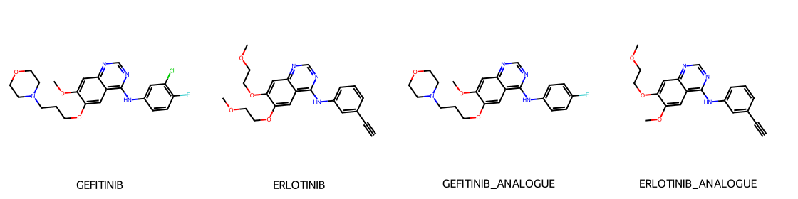

# chem-ops

Cheminformatics for compound screening, as a Claude Code plugin. Built on
[RDKit](https://www.rdkit.org/), for medicinal chemists triaging hits, filtering decks and making
sense of a screening output.

It does the arithmetic and the bookkeeping — descriptors, filter cascades, alert catalogs, clustering,
scaffolds, series cores — and leaves the chemistry judgment to you, with the evidence laid out to
argue with.

```
/plugin marketplace add bosons14/chem-ops
/plugin install chem-ops@chem-ops
```

Needs Python 3.10+ on your `PATH`. On first run the MCP server installs RDKit into its own cache
venv, or uses [uv](https://docs.astral.sh/uv/) if you have it. Nothing is installed globally.

## What it does

| Skill | Use it for |
|---|---|
| `/screen-library` | Filter a deck through a property/rule/alert cascade, with the attrition reported stage by stage. Salt stripping, charge neutralization and InChIKey deduplication first. |
| `/molecule-profile` | Full read on one compound or a handful: descriptors, every drug-likeness rule with the specific criteria failed, synthetic accessibility, and ligand efficiency (LE, LLE, LELP) when you have potency. |
| `/hit-triage` | Turn a hit list into series: Butina clustering, Bemis-Murcko scaffolds, MCS series cores, similarity expansion, and a diverse representative set to follow up. |
| `/alerts-review` | PAINS, Brenk, NIH, ZINC and ChEMBL house filters — interpreted rather than obeyed, with the experiment that would settle each case. |

Plus a `hit-list-analyst` agent for an independent review of a selection before you spend money on
it — a second read from someone who did not do the original triage.

### MCP tools

`chem_tool_status`, `molecule_profile`, `structural_alerts`, `screen_library`,
`standardize_library`, `similarity_search`, `cluster_library`, `scaffold_analysis`, `series_core`,
`depict_molecules`.

They read `.csv`, `.tsv`, `.smi`, `.txt` and `.sdf` (any of them `.gz`), auto-detect the SMILES and
ID columns, carry your own columns through to the output, and write `.csv` or `.sdf`. Structures are
drawn to `.png` or `.svg` — a series can be aligned on its common core, which is the artefact worth
actually looking at:



## Example

```
> screen examples/screening-hits.csv: MW 250-550, cLogP under 5, must pass Lipinski and Veber
```

```
24 compounds in, 1 duplicate collapsed (ASPIRIN and ASPIRIN_DUP are the same molecule),
1 row would not parse.

  deduplicate (InChIKey)          24 -> 23
  property filters (mw, clogp)    23 -> 10
  rule sets (Lipinski, Veber)     10 -> 10

10 passed. 14 carry a structural alert, flagged not dropped — see below.
```

That last line is the point. Running the same file with alerts set to `reject` discards gefitinib and
erlotinib, two marketed EGFR inhibitors, on Brenk's `Aliphatic_long_chain` and `triple_bond`. The
default is to flag and let you look.

## What it does not do

Worth being plain about, so you know where the boundary is:

- **No activity, affinity or selectivity prediction.** Nothing here estimates whether a compound
  works. That is an assay result.
- **No docking, no molecular dynamics, no 3D.** Everything is 2D/topological. Structure-based work is
  a separate problem.
- **No ADMET, solubility, metabolic stability, hERG or toxicity models.** Structural alerts flag
  *known* liability substructures; they are not predictions.
- **cLogP is calculated**, not measured, and routinely differs from experimental logD by a log unit
  or more.

The rule sets (Lipinski, Veber, Egan, Ghose, Rule of 3, lead-likeness) are triage guidelines derived
from specific datasets for specific questions, and the skills say which. A quarter of orally
administered approved drugs break at least one.

## Development

```
pip install rdkit pytest "mcp>=1.2,<3"
python -m pytest -q tests
claude --plugin-dir .
```

42 tests, checked against literature values for known drugs (aspirin, caffeine, imatinib, taxol) and
against known PAINS and reactive substructures.

## Licence

MIT. Author: Subhendra Basu ([@bosons14](https://github.com/bosons14)).

Built on RDKit (BSD-3-Clause). Filter catalogs are from Baell & Holloway, *J Med Chem* 53 (2010)
2719; Brenk et al., *ChemMedChem* 3 (2008) 435; and the NIH, ZINC and ChEMBL filter sets distributed
with RDKit. Synthetic accessibility is Ertl & Schuffenhauer, *J Cheminform* 1 (2009) 8.
